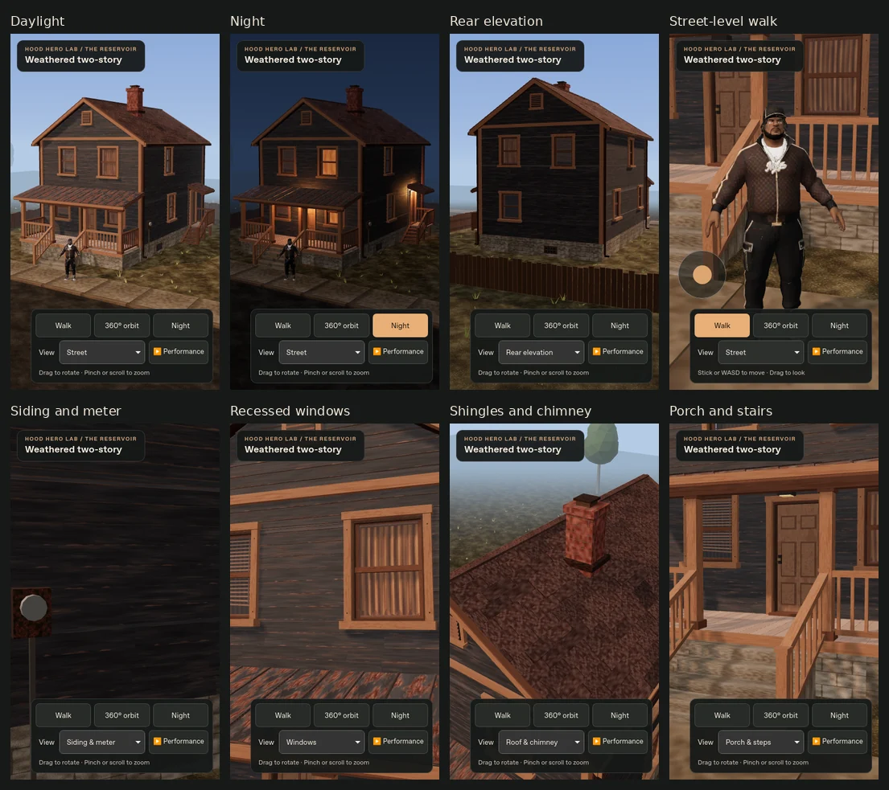

# Weathered two-story house

A stand-alone Reservoir test lot for the owner’s two-story house reference. The front and right elevations follow the visible siding, roof, window and entrance layout. The left and rear continue the same wall construction with simpler sash placement and a rear foundation vent. The reference image guides the model and material colors. The texture maps are original, generated by [generate.py](textures/generate.py). The scale character is the existing Mega model.

## Play the showcase

From this branch, run `npm ci` and `npm run dev`. Open `http://localhost:5173/reservoir-house.html`. On a phone on the same network, use the Network URL printed by Vite and append `/reservoir-house.html`.

- **Walk** turns on the touch stick and a third-person camera. Drag the scene to look around. WASD and arrow keys also move the character. Both stairways lead to a walkable landing at a closed door.
- **360° orbit** travels around all four elevations. Drag to take over, and use a pinch or scroll to change distance.
- **View** includes close-ups of the siding and utility meter, recessed windows, chimney and shingles, porch, side stairs, and rear.
- **Night** toggles the moonlight, warm curtain glow, and entrance fixtures. **Performance** displays rolling frame rate, 95th-percentile frame time, drawing-buffer size, visible-pass draw calls, and triangles.

## Integrate into the City

The mesh is in metres with Y up and the front facing +Z. The origin is at grade beneath the center of the front wall. The wall body is 6.35 × 8.60 m. Ground and upper finished floors are approximately 0.78 and 3.47 m above grade. The solid model is an exterior shell with recessed glazing and closed 2.07 m doors.

The [Three.js source](house.ts) is the editable version. Load the atlases once and share them across house instances.

```ts
const textures = await loadHouseTextures();
const house = createReservoirHouse(textures);
scene.add(house.root);
house.setNight(isNight);
```

Transform `house.collision` and `house.entrances` by the same lot transform as the render group. `walkable` contains metre-space treads and landings with surface heights. `blockers` contains the wall shell, railings and the low porch roof. The thresholds identify the door positions, and the approach points are usable from the top landings. The showroom’s movement and camera are isolated from the City. Claude chooses the lot, block collision adapter, and any City interactions.

The packed [GLB](weathered-reservoir-house.glb) is an alternative for the City’s GLTFLoader pipeline. It embeds the maps and the geometry, with collision and entrance data in the root’s glTF `extras` (Three.js `userData`). Enable `MeshoptDecoder`. The export contains the daylight materials and modeled fixtures. The Three.js factory supplies the light and emission controls for both lighting states.

### Rebuild the portable model

Run the Vite dev server at its default base. From the repository root, use the commands below after installing Playwright Chromium. The first export requires a fresh output path.

```sh
npx playwright install chromium
node src/showcases/reservoir-house/export.mjs http://127.0.0.1:5173 /tmp/weathered-house.glb
npx @gltf-transform/cli@4.5.1 webp /tmp/weathered-house.glb /tmp/weathered-house-webp.glb --quality 89
npx @gltf-transform/cli@4.5.1 meshopt /tmp/weathered-house-webp.glb /tmp/weathered-reservoir-house.glb --quantize-texcoord 14
npx @gltf-transform/cli@4.5.1 validate /tmp/weathered-reservoir-house.glb
```

The GLB excludes the showroom terrain and the scale character. For source atlas changes, run `python src/showcases/reservoir-house/textures/generate.py` with Pillow and NumPy before exporting.

## Mobile review



The house has **10,392 triangles across seven meshes**. The decoder-free preview maps total 646 kB across one base-color atlas, one normal atlas, and one packed occlusion, roughness and metalness atlas. The packed GLB is 862 kB. It validated with zero errors and warnings and imported through Three.js with the two entrances and twelve walkable surfaces in its metadata.

Measurements below come from the extracted preview bundle in headless WebKit on this Linux workspace. The drawing buffer was **390 × 664 at 1×**, with software rendering. Each range covers three live performance samples. The walk sample is taken at the starting street-level camera while the character is standing. Phone GPU performance remains unmeasured.

| View | FPS | p95 frame time | Draws | Scene triangles |
| --- | ---: | ---: | ---: | ---: |
| Daylight street view | 2.9–4.4 | 251–485 ms | 14 | 31,106 |
| Night street view | 4.0–4.1 | 273–316 ms | 14 | 31,106 |
| Walk view at spawn | 1.9–2.2 | 490–559 ms | 13 | 31,058 |

Draw counts and triangle totals are from the visible pass. The app redraws on interaction, during motion, and while the Performance panel is sampling. It caches the shadow map between changes to lighting and the scale character.
