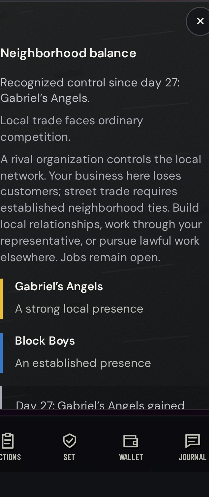

# Living rivalry prototype

This loop extends the existing faction decision and territory resolver. It adds no factions, characters, campaign objectives, save fields, or terminal defeats. Canonical names and IDs are unchanged (including the existing `blocks` / “Block Boys” records).

## Play it in the City

Open **The Reservoir → The water tower → Read The Reservoir politics**. The existing district panel explains control, visible footholds and the player's exposure. Its existing **Influence this neighborhood** section uses the same political actions, representatives, authority, AP, money and cooldown rules as before. The water tower link now actually opens that panel.

- Build community support without joining an organization. Local standing can preserve street access even under a hostile controller; lawful employment never requires faction permission.
- Members can support local interests through a trusted representative. Contributors can back operations and negotiate cooperation. Organizers can challenge a present enemy or propose a territorial priority.
- These investments now build organizational local support as well as their original influence, economy or pressure effects. Cooperation provides the largest relationship-support investment. This is the existing cooperation mechanic, not a new truce or forced agreement with a rival NPC.
- Challenges disrupt actual enemies and improve the player's faction's position. Priorities affect the existing autonomous decision scores. Sustained qualifying dominance still needs seven daily resolutions; a button never assigns territory.

## Independent factions

`NPCDecisionAI` continues to run NPC jobs, social lives and street actions. Its existing responsibilities needed no changes. `advanceFactions` independently chooses recovery, maintenance, economy, expansion or contest from resources, instability, territory deficits, rival pressure, alliances and player proposals.

Contests now include the same small local social investment already made during expansion and maintenance. This addresses the local-support bottleneck without replacing the AI, adding random decisions, weakening control requirements or scheduling victories. Factions can build footholds, undermine competitors, consolidate control, lose it, and recover. Their resources and instability continue to constrain those choices.

## Stakes

- A recognized territorial loss removes up to $60 of the displaced faction's operating resources and adds six instability. A gain adds up to $40 of resources and eases two instability. These occur once per transition; existing decision costs, caps, upkeep and recovery still apply.
- Actual enemy control restricts affiliated street traders below the existing local-standing requirement. The rivalry check reads both factions' actual enemy lists; neutral, same-faction and allied residents are not automatically enemies.
- An enemy-affiliated owner's local business now faces an additional 0.20 disruption in the existing revenue calculation. Gross revenue, net income, cash, arrears and sustainable-income history all use the real result. No property is confiscated and lawful jobs remain open.
- Everyone can still feel existing contested-neighborhood trade disruption. Independent and allied businesses receive no affiliation penalty.
- Losing territory also reduces actual stabilized control for the unchanged Underlord conditions. Territorial defeats do not end a run.

The City publishes trader reports when challenges develop, before recognized control changes, with repeat reports limited to once per neighborhood per fourteen days. Major control notices describe the commercial consequences. These are ordinary observed events, retained in existing campaign history. The neighborhood view gives qualitative, affiliation-aware advice without displaying AI scores or intentions.

Current territory and actual affiliation determine continuing access and business effects. A reversal immediately removes those rules; earlier lost money and recorded earnings remain historical facts. The normal business settlement updates future earnings and the existing rolling income history over time.

## Validation evidence

`src/tests/rivalry.test.ts` covers:

1. **Passive campaigns:** three full 365-day `advanceDay` campaigns, seeds 17, 2026 and 31415, with no player actions or faction-state manipulation. Each reached day 366 without ending. In each, the Blips established Nawf control on day 84, Mudgang displaced them on day 201, and the Blips recovered it on day 316. Block Boys took Rio Gabriel from the Angels on day 254. Angels made sixteen contest decisions while pursuing the Reservoir, but did **not** capture it in these runs. The same outcomes across seeds reflect the existing deterministic strategic scoring; these dates are observations, not triggers or guarantees.
2. **Affiliated setback:** a controlled late-campaign Reservoir balance, resolved through the real seven-day stabilization rule. A Block Boys organizer receives a warning before Angels control, loses faction funds and street access, and earns less from the laundry than an otherwise identical unaffiliated owner. Control, funds, earnings history and access survive serialization. Repeated same-day resolution does not charge the loss again.
3. **Counterplay:** from that defeat, paid, cooldown-limited challenges through the existing Block Boys contact restore control. An identical passive branch stays lost. Access and affiliation-based business exposure update on reversal. Support, operations, cooperation and priorities also exercise the existing influence/decision interface. These deterministic transition tests deliberately isolate the resolver from autonomous daily choices; the full campaigns above test the complete daily simulation.
4. **Unaffiliated lawful player:** the same hostile territorial transition does not deny gigs, community support, street access based on local standing, or business acquisition. A subsequent 35-day campaign with the clean-funded laundry earns real profits and meets existing legitimate-retirement requirements. Retirement remains voluntary.

`tests/rivalry.spec.ts` starts on the City board, finds the water tower, reads the loss, completes a paid challenge, and checks AP, cash, influence and save/reload at 390px and 320px. No new menu shortcuts or board assets are needed.

## Save and ownership boundaries

No schema/version, production save key, canonical character, model, location registry, victory condition or deployment workflow changed. Existing saved controllers receive the continuing affiliation rule on their next business settlement; past transitions are never replayed for one-time financial adjustments. Existing ledger and territory history remain authoritative.

Cross-owner review is limited to the one-line application-level politics-link fix and the extra read-only neighborhood explanation in `StrategyPanels`. No `src/board/**` files changed. Claude should check that district navigation and information fit the current board before merging.

## Before NPC-driven terminal defeat

This prototype establishes reversible stakes, not a defeat specification. A separate design must define what the player permanently loses, which affiliations/paths qualify, sufficient actionable warning and recovery windows, how surrender/negotiation/succession work, and what happens when representatives or income sources become unavailable. It must preserve an independent lawful route and distinguish a territorial setback from irreversible defeat, then validate those rules against long campaigns, custody, death/succession and old saves. No rival-territory Game Over should be inferred from this PR.

## Review checks

- `npm test`: 29 files, 445 tests passed, including all four scenarios above and existing victory/save compatibility tests.
- `npm run build`: passed (existing Vite chunk-size advisory).
- City board regression (`tests/board.spec.ts`): three cases passed on each of Chromium and WebKit, including walking/action/save, production-key isolation and leaving the City mid-walk.
- Rivalry City flow (`tests/rivalry.spec.ts`): two viewport cases per engine. The final pass also reads and acknowledges actual takeover and early-pressure notices before completing counterplay.
- WebKit's dependencies were unavailable globally in this unprivileged environment. Debian snapshot libraries were extracted into its local browser bundle; the final WebKit run used `PLAYWRIGHT_SKIP_VALIDATE_HOST_REQUIREMENTS=1` because Playwright's `ldconfig` probe cannot see those local libraries. The actual browser, WebGL board and gameplay assertions ran; no repository configuration or tests were disabled. Earlier launches failed on missing host libraries before reaching the app.
- The full browser suite was not run; browser validation was targeted to the changed flow and the existing board integration.

