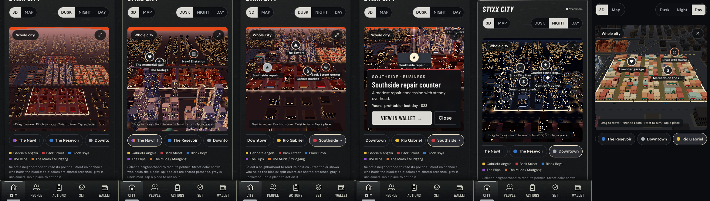

# Stixx City in 3D — experimental branch `stixx-3d-city`

The City screen's 2D map becomes a living, explorable strategy board. You don't control a character. You move a camera over Stixx City, read its politics from the streets, and tap places to act through the game's existing systems.

The 2D map stays one tap away (**3D | Map**). It also loads automatically on devices without WebGL.

Individual captures: [docs/review/city-3d](review/city-3d/).

## What you can do

- **Explore.** Drag to move, pinch to zoom, twist with two fingers to turn. **Whole city** returns to the overview, and ⤢ opens a full-screen city on the phone.
- **Select a neighborhood** by tapping its blocks or a chip under the board. The camera flies there, and the existing Neighborhood panel below updates exactly as before.
- **Tap a place** (pins appear once a district is selected). A card shows live state and one action that routes into a system that already exists:

| District | Places |
| --- | --- |
| Downtown | City Hall, Central Precinct, Courier route depot (business), Downtown storefronts (job) |
| Southside | The Towers, Southside repair counter (business), Back Street corner, Corner market (job) |
| The Resevoir | Resevoir laundry (business), Westside warehouse (job), the lot court, corner store (job) |
| Rio Gabriel | Lowrider garage, Mercado on the river (job), River wall mural |
| The Nawf | The bodega (job), the memorial wall, Nawf El station |

Each card opens one of these: **Actions** (Honest or Streets tab), **People** (meet locals), **Wallet** (businesses), or the neighborhood politics panel. Each business and job place maps to a real `BUSINESSES` or `JOBS` entry, and a unit test enforces this.

## How the city reflects the game

All of this comes from saved state through a read-only view model (`src/city3d/viewModel.ts`). Exploring never changes the save, and a test checks that.

- **Faction control:** each district's streets glow in the controller's color. Shared presence splits the color by each faction's share, so The Nawf shows Blips purple next to Mudgang brown. Unclaimed is gray. Rooftop flags appear in proportion to each faction's presence.
- **Contested districts** pulse orange at their borders.
- **Police:** patrol cars with flashing light bars. Each district gets one car per ~22 points of police presence, so Downtown is crawling with them.
- **Neighborhood conditions:** sidewalk foot traffic follows civilian support and commerce. Crowds at street corners and the El follow each district's street-market activity. These are people on a corner and nothing more specific.
- **Consequences:** effects from the last two days ripple out from a district's center. Red means tension (challenges, disruption, reputation loss) and green means calm (community and support work).
- **Your footprint:** businesses you own get a light column in your affiliation color, and your job gets a white one. Your home district is marked, and the business card shows status and last-day net.
- **Time of day:** Dusk (matches the neighborhood art), Night (lit windows, streetlight pools, police lights) or Day. This setting is a viewing choice and has no game effect.

## Art direction

The look follows the existing neighborhood illustrations, since each district is built from its own brief:

- **Downtown:** a limestone and glass skyline, a domed City Hall, docks with container stacks and cranes on the river.
- **Southside:** brick rows, bare trees and the Towers' balcony-striped slabs.
- **The Resevoir:** gabled houses, boarded windows, vacant lots and a hoop on a lot.
- **Rio Gabriel:** warm stucco, awnings, palms, lowriders outside the garage and a river mural.
- **The Nawf:** walk-ups with water tanks, an elevated train that runs, the yellow-awning bodega and the defaced memorial with candles.

The surrounding city fades into fog so the five districts read as the living part of the board. The river follows the 2D map's path, and the district layout matches the 2D map exactly.

Everything is procedural, so there are no model files to download. The renderer is about 140 kB gzipped and loads only when the 3D city is shown, so the main game bundle is unchanged.

## iPhone performance choices

- Static buildings are merged into a few draw calls per district. Cars, people, lamps and flags are instanced.
- The shadow map is baked once per lighting change, not every frame.
- The pixel ratio is capped at 1.5. Ambient animation runs at about 30 fps, and gestures get full frame rate.
- Rendering stops when the board scrolls off screen or the tab is hidden.
- One city is built per session. Leaving the City screen detaches it instead of destroying it, so coming back is instant (6.3 s → 0.66 s measured in software rendering).
- Devices with no GPU acceleration get a lighter mode: Lambert shading, no shadows, and animation only while you touch the city.
- `prefers-reduced-motion` gives a still city that moves only when you interact.
- If WebGL fails, the 2D map takes over automatically.

## Files

- `src/city3d/layout.ts`: district geometry (mirrors `CityMap`), river path and place definitions.
- `src/city3d/viewModel.ts`: read-only projection of game state.
- `src/city3d/CityRenderer.ts`: three.js scene, camera, gestures and animation.
- `src/ui/CityView.tsx`: 3D/Map toggle, district chips, time of day, full screen and fallback.
- `src/ui/City3D.tsx`, `src/ui/city3d.css`: labels, place pins and place cards.
- `src/ui/App.tsx`: renders `CityView` and routes place cards to existing screens.
- Tests: `src/tests/city3d.test.ts` and `tests/city3d.spec.ts`. `tests/city-menu.spec.ts` now switches to Map to check the 2D gradients.

No simulation rules, content, save schema or balance values changed.

## Known limits / next steps

- Validated with software-rendered Chromium at iPhone 13 size: 178 unit tests and 66 e2e tests run, 65 passed. The other one is the review/WCAG capture test. Its accessibility checks passed, but it failed on a `favicon.ico` 404 that only the full Chromium build used here requests, and on its own time limit with software rendering. WebKit wasn't run here. Physical iPhone frame rate still needs a real-device check.
- Places are fixed per district. A natural next step is letting businesses you buy, or territory changes, alter buildings (signage, boarded vs. open storefronts).
- Time of day could follow the game day (for example, End Day plays a night-to-morning transition).
